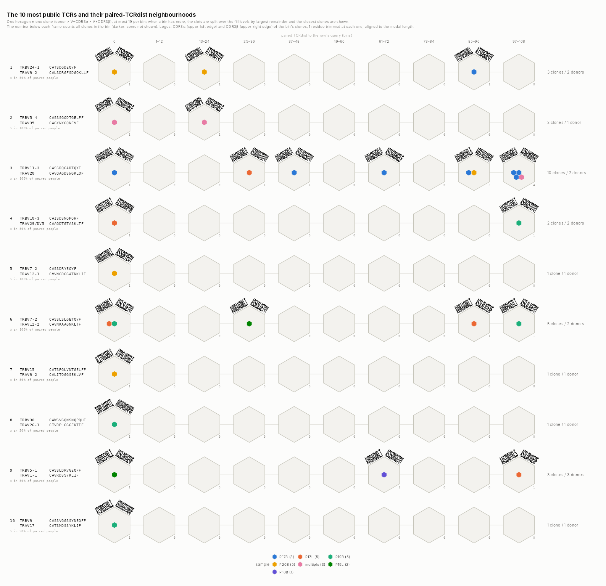
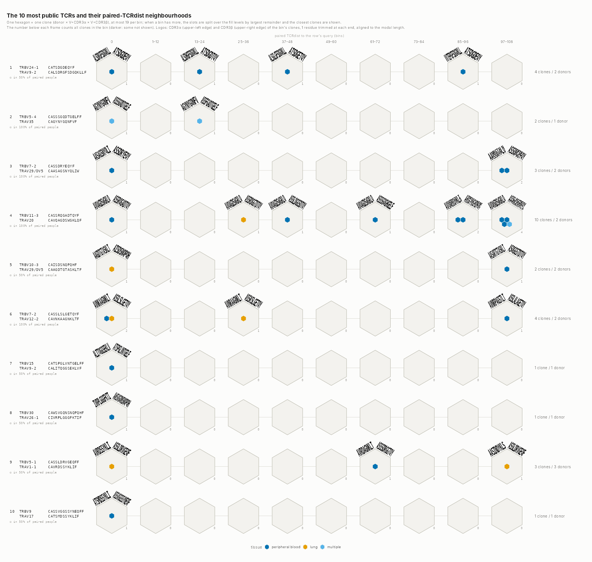
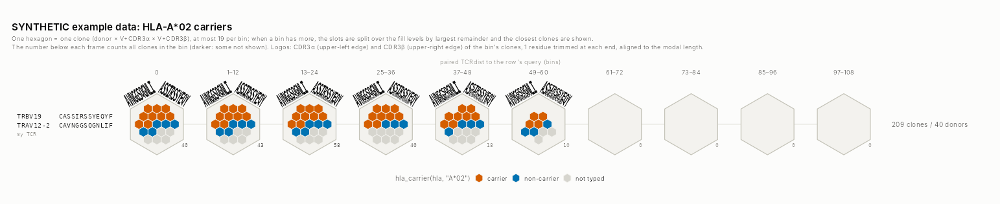
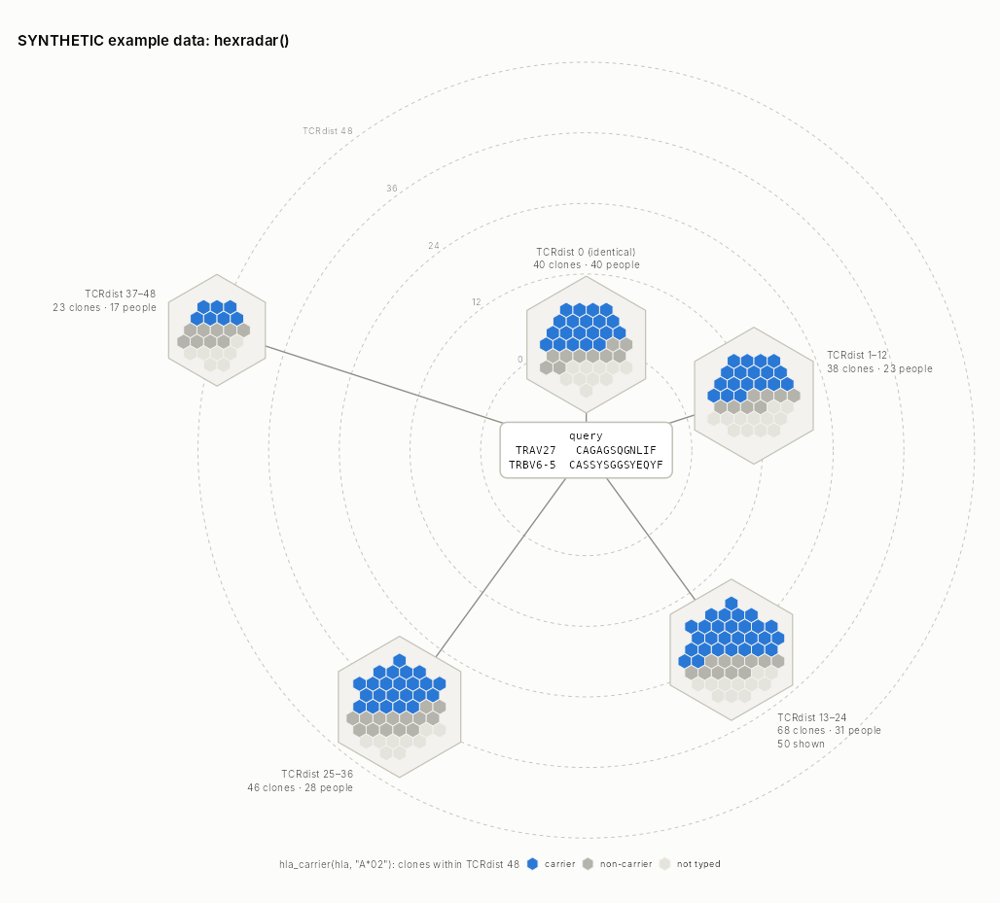

# tcrhex

Paired TCRdist **hex rows** from single-cell TCR data, drawn with ggplot2.

One row per query TCR (TRAV + CDR3α, TRBV + CDR3β). Along the row, one
hexagonal frame per paired-TCRdist bin (0, 1–12, 13–24, … up to the search
radius). Inside each frame, one small hexagon per clone (donor × TRAV + CDR3α
× TRBV + CDR3β), up to 19, coloured by **any** categorical column of your
data. The frames also carry frequency logos of the bin's CDR3α and CDR3β.

* **Input**: ordinary single-cell TCR metadata: scRepertoire (`combineTCR()`
  lists, or Seurat / SingleCellExperiment objects after `combineExpression()`),
  10x Cell Ranger `filtered_contig_annotations.csv`, AIRR rearrangement TSV, or
  any data frame.
* **Paired TCRdist**: reproduces tcrdist3's defaults exactly, for human and
  mouse (tested against tcrdist3 0.3 on 322,380 query × clone pairs). Only queries are
  compared against all clones, in C++: 20 queries × 500,000 clones take
  about 5 s.
* **ggplot-like**: `hexrows(cells, aes(fill = <any column or expression>))`
  returns a ggplot, so `+ scale_fill_*()`, `+ labs()` and `+ theme()` work.

## Install

From GitHub:

```r
install.packages("remotes")
remotes::install_github("shihanli92/tcrhex")

# with the vignette (needs knitr + rmarkdown; scRepertoire for its examples)
remotes::install_github("shihanli92/tcrhex", build_vignettes = TRUE)
vignette("tcrhex")
```

`pak::pak("shihanli92/tcrhex")` works too. The examples use scRepertoire's public
data, which comes from Bioconductor:

```r
install.packages("BiocManager")
BiocManager::install("scRepertoire")
```

The package compiles a small C++ kernel, so it needs build tools: Rtools on
Windows, or the Xcode command-line tools on macOS (`xcode-select --install`).
Linux needs `r-base-dev` or an equivalent.

## Examples

All examples use public data (scRepertoire's bundled `contig_list` /
`scRep_example`: 4 patients, peripheral blood and lung) or the package's
**synthetic** example cells.

### 1. scRepertoire output, `aes(fill = )` any column

```r
library(tcrhex)
library(scRepertoire)
library(ggplot2)

data("contig_list")
samples <- c("P17B", "P17L", "P18B", "P18L", "P19B", "P19L", "P20B", "P20L")
combined <- combineTCR(contig_list, samples = samples)

cells <- read_screpertoire(combined, donor = sub("[BL]$", "", sample))
#> tcrhex cell table (scRepertoire): 27,185 cells, 22,526 paired (TRA+TRB), 4 donors
#>   unpaired, kept for top_public() but not for TCRdist: 798 alpha-only, 3,861 beta-only
#>   cells with 2+ chains of one locus (one kept): 2,965 TRA, 2,477 TRB
p <- hexrows(cells, aes(fill = sample), queries = top_public(cells, 10))
ggsave_hexrows("samples.png", p)
```

A Seurat or SingleCellExperiment object after `combineExpression()` works the
same way, and all of its meta data columns are available:
`read_screpertoire(sobj, donor = patient)` followed by
`hexrows(cells, aes(fill = seurat_clusters))`. A clone whose cells fall in
several clusters is coloured `"multiple"`. Pass
`summarise_fill = summarise_most_common` to use the most frequent cluster
instead.



### 2. 10x contigs + a metadata table, with `scale_fill_manual()`

```r
files <- c(P17B = "P17B/filtered_contig_annotations.csv",
           P17L = "P17L/filtered_contig_annotations.csv")  # ... one per sample
# (with the bundled example: files <- setNames(contig_list, samples))
meta <- data.frame(sample  = samples,
                   patient = sub("[BL]$", "", samples),
                   tissue  = ifelse(grepl("B$", samples), "peripheral blood", "lung"))

cells <- read_10x_contigs(files, meta = meta, by = "sample", donor = patient)
#> tcrhex cell table (10x contigs): 27,185 cells, 22,526 paired (TRA+TRB), 4 donors
#>   unpaired, kept for top_public() but not for TCRdist: 798 alpha-only, 3,861 beta-only
#>   cells with 2+ chains of one locus (one kept): 2,965 TRA, 2,477 TRB

p <- hexrows(cells, aes(fill = tissue), queries = top_public(cells, 10)) +
  scale_fill_manual(values = c("peripheral blood" = "#0072B2", lung = "#E69F00",
                               multiple = "#56B4E9"))
ggsave_hexrows("tissue.png", p)
```



Free-text tissues can be grouped into compartments with `tissue_class()`. Use
`summarise_tissue` to turn a blood + lung clone into "blood + tissue", and the
colour-blind-safe tissue colour and pattern scales:

```r
hexrows(cells, aes(fill = tissue_class(tissue), pattern = tissue_class(tissue)),
        summarise_fill = summarise_tissue) +
  scale_fill_tissue() + scale_pattern_tissue()
```

### 3. Your own query TCR, coloured by HLA carrier status

```r
cells <- tcrhex_example_cells(n_donors = 40)   # SYNTHETIC cells with an `hla` column
p <- hexrows(cells, aes(fill = hla_carrier(hla, "A*02")),
             queries = c("my TCR" = "TRAV12-2:CAVNGGSQGNLIF:TRBV19:CASSIRSSYEQYF")) +
  scale_fill_manual(values = c(carrier = "#D55E00", "non-carrier" = "#0072B2",
                               "not typed" = "#d6d5ce"))
```



`hla_enriched()` finds, for each row, the allele most over-represented among
the donors near the query. Map it with
`aes(fill = hla_carrier(hla, .row_allele))`: every column of the query table
is available as `.row_<column>`. See the vignette.

### The most expanded clone per tissue (or per anything)

```r
q <- top_expanded(cells, n = 1, by = tissue)   # n clones per tissue, most cells first
hexrows(cells, aes(fill = tissue), queries = q)
```

`by` is any column or expression (`by = paste(tissue, timepoint)`). Each row is
tagged with its group and cell count. Without `by`, it picks the n most
expanded clones overall.

### One clone, compact: `hexradar()`

```r
hexradar(cells, aes(fill = hla_carrier(hla, "A*02")),
         query = "TRAV27:CAGAGSQGNLIF:TRBV6-5:CASSYSGGSYEQYF")   # or top_expanded(cells, 1)
```

The query sits in the centre. Each distance bin is a frame on its dashed
TCRdist ring (0, 12, 24, …, `radius = 48` by default), joined to the query by
a spoke and labelled "TCRdist 1–12 · 125 clones · 95 donors · 50 shown". Fill,
patterns, scales, `cumulative`, `logos` and `gene_logos` work as in
`hexrows()`. Use `donor_noun = "people"` (or `"mice"`) to change the label
wording.



### Gene-usage logos

`hexrows(..., gene_logos = TRUE)` adds V and J gene logos on the two lower
edges of every frame: alpha on the lower-left edge (TRAV stack, then TRAJ),
beta on the lower-right (TRBV, then TRBJ). V and J are counted independently.
Each gene is one word, sized by its share of the bin's clones. Only genes with
≥10% are drawn, at most 4 per stack (`gene_min_freq`, `gene_max`). J genes come
from the readers (10x `j_gene`, AIRR `j_call`, scRepertoire `CTgene`), or from
`map = c(ja = ..., jb = ...)` in `cells_from_df()`.

### Cumulative bins

`hexrows(..., cumulative = TRUE)` makes each frame hold every clone up to its
distance (0, ≤12, ≤24, …, ≤108). The hexagon composition, the counts and the
CDR3 logos then accumulate as the neighbourhood widens.

### Mouse

Pass `organism = "mouse"`. This uses tcrdist3's mouse V-gene loops, and the
distances match `TCRrep(organism = "mouse")` exactly. One row per cell with
AIRR-style columns (for example `v_call_vj`, `junction_aa_vj`, `v_call_vdj`,
`junction_aa_vdj` in a Seurat `meta.data`) goes through `cells_from_df()`:

```r
md <- as.data.frame(dplyr::ungroup(sobj@meta.data))
md$barcode <- colnames(sobj)
cells <- cells_from_df(md, map = c(cell = "barcode", donor = "mouse_id",
                                   va = "v_call_vj",  ca = "junction_aa_vj",
                                   vb = "v_call_vdj", cb = "junction_aa_vdj"))
p <- hexrows(cells, aes(fill = seurat_clusters),
             queries = top_public(cells, 20, organism = "mouse"))
```

The organism set in `top_public()` (or `tcrdist_paired()`) carries over to
`hexrows()`. With user-given queries, set `hexrows(..., organism = "mouse")`.

## The pieces

| function | what it does |
|---|---|
| `read_screpertoire()`, `read_10x_contigs()`, `read_airr()`, `cells_from_df()` | one validated cell table, with a summary of dropped / unpaired / multi-chain cells |
| `tcr_clones()` | donor × TRAV+CDR3α × TRBV+CDR3β clones; every metadata column summarised by one rule |
| `tcrdist_paired()` | query × clone paired TCRdist (`d`, `d_a`, `d_b`) within a radius |
| `top_public()` | the n beta chains in most donors, each with its dominant alpha and concordance |
| `top_expanded()` | the n clones with most cells, overall or per level of any column (`by = tissue`) |
| `hexrows()` / `hexrows_data()` | the figure / the tidy data behind it (incl. the per-bin table) |
| `hexradar()` / `hexradar_data()` | compact single-query version: bins as frames on TCRdist rings around the query |
| `tissue_class()`, `summarise_tissue()`, `scale_fill_tissue()`, `scale_pattern_tissue()` | tissue compartments |
| `hla_carrier()`, `hla_enriched()` | HLA carrier status, per-row enriched allele |
| `ggsave_hexrows()` | saves with a page sized to rows × bins (0.072 in per hexagon unit) |

## Licences

MIT. The V-gene loop table is derived from tcrdist3's
`alphabeta_gammadelta_db.tsv` (MIT, © 2020 Koshlan Mayer-Blackwell). The logo
letters are traced from DejaVu Sans Mono Bold (Bitstream Vera licence). See
`inst/COPYRIGHTS`.
